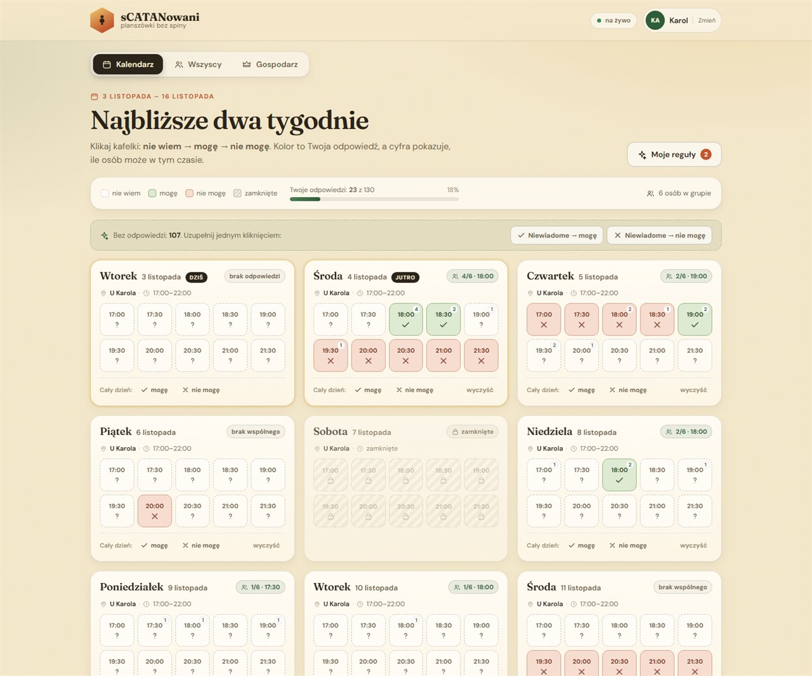

# sCATANowani — kto może w planszówki?

Wspólny kalendarz dostępności dla grupy **sCATANowani**. Zamiast przekopywać czat, każdy
zaznacza kiedy może, a aplikacja pokazuje najlepsze terminy na najbliższe dwa tygodnie.

**Aplikacja:** https://karoletrych.github.io/scatanowani/



## Jak zacząć

1. Wejdź na link i podaj imię — bez konta i hasła.
2. Gospodarz w zakładce **Gospodarz** ustawia okna (np. 17:00–22:00) i ewentualne wyjątki.
3. Każdy klika swoje sloty albo dodaje reguły w **Moje reguły**.
4. W zakładce **Wszyscy** widać najlepsze terminy i mapę dostępności.

## Co potrafi

- **14 dni do przodu** w slotach co 30 minut, domyślnie 17:00–22:00 (gospodarz zmienia).
- **Trzy stany**: nie wiem (domyślnie) → mogę → nie mogę. Kliknięcie kafelka przełącza.
- **Masowe wypełnianie**: jednym kliknięciem oznacz wszystkie pozostałe niewiadome jako
  „mogę” albo „nie mogę” — z cofnięciem i bez ruszania jawnych odpowiedzi.
- **Reguły cykliczne**: np. „w każdy czwartek do 19:00 nie mogę”, „w każdą środę od 19:20 nie mogę”.
- **Jednorazowe wyjątki**: konkretna data i godziny.
- **Szybkie „cały dzień”**: jednym kliknięciem mogę / nie mogę, plus czyszczenie dnia.
- **Okna gospodarza**: poza nimi sloty są zablokowane i nie liczą się do podsumowań.
- **Kopia zapasowa**: panel gospodarza kopiuje całą tablicę (ustawienia, osoby, odpowiedzi)
  do schowka jako JSON.
- **Podsumowanie**: ranking najlepszych terminów, mapa ciepła i kto ile wypełnił.
- **Na żywo**: zmiany innych osób pojawiają się bez odświeżania (Firebase).
- **Bez logowania**: podajesz imię i działa. Imię jest pamiętane w przeglądarce.

## Jak działa dostępność

1. Gospodarz ustala **okna** (np. wszystkie dni 17:00–22:00) i ewentualne wyjątki dla konkretnych dat.
2. Uczestnik ma domyślnie **„nie wiem”** i doklikuje odpowiedzi.
3. Kolejność pierwszeństwa: **kliknięty slot → wyjątek jednorazowy → reguła cykliczna**.
4. Godziny reguł dotyczą **startu slotu** — reguła „środy po 19:20” blokuje sloty od 19:30.

## Stack

- **Vite + React + TypeScript**, własny CSS i SVG (bez bibliotek UI).
- **Firebase Firestore** — wspólny stan i synchronizacja na żywo.
- **GitHub Pages** + GitHub Actions — hosting statyczny.

Projekt Firebase: `scatanowani`, baza nazwana `default` (projekt nie ma włączonego billingu,
więc nie korzystamy z bazy `(default)`). Reguły bezpieczeństwa są celowo otwarte.

## Lokalnie

```bash
npm install
npm run dev      # http://localhost:5173
npm run build    # produkcyjny build do dist/
npm run typecheck
```

Podgląd bez chmury (dane tylko w przeglądarce): `http://localhost:5173/?local=1`.

Szybkie wejście jako osoba: `?name=Karol`, a widok: `?tab=summary` lub `?tab=host`.

## Deploy

Push na `main` uruchamia workflow `.github/workflows/deploy.yml`, który buduje aplikację
z `VITE_BASE=/scatanowani/` i publikuje `dist/` na GitHub Pages.

Firestore rules:

```bash
firebase deploy --only firestore:rules --project scatanowani
```

## Bezpieczeństwo

Aplikacja **nie ma autoryzacji** — to świadoma decyzja: kto ma link, ten może czytać i pisać.
Panel gospodarza też jest otwarty. Nie trzymamy tu żadnych danych wrażliwych, tylko imiona
i dyspozycyjność.
